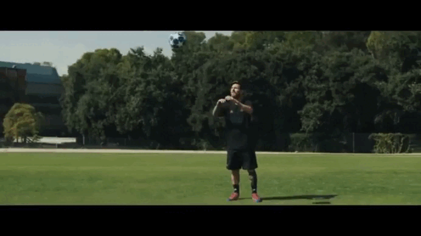

# Sport Action Recognition CNN3D

Classification d'actions sportives en vidéo avec un CNN 3D entraîné sur UCF101.

## Résultat

Le modèle analyse une vidéo et affiche en temps réel le mouvement détecté avec le score de confiance pour chaque classe.

## Actions reconnues

- JumpingJack
- Punch
- SoccerJuggling

## Performances

- **Test accuracy : 90.74%**
- Dataset : UCF101 (315 vidéos d'entraînement, 55 vidéos de test)

## Architecture

CNN 3D avec 3 blocs Conv3D + MaxPooling3D, suivi d'une couche Dense 256 avec Dropout 0.5.

Chaque prédiction est faite sur une séquence de 16 frames extraites uniformément.

## Lancer le notebook

Ouvrir directement sur Kaggle avec GPU activé (P100).

Le dataset utilisé : [UCF101 Action Recognition](https://www.kaggle.com/datasets/matthewjansen/ucf101-action-recognition)

## Stack

Python, TensorFlow/Keras, OpenCV, NumPy, scikit-learn
